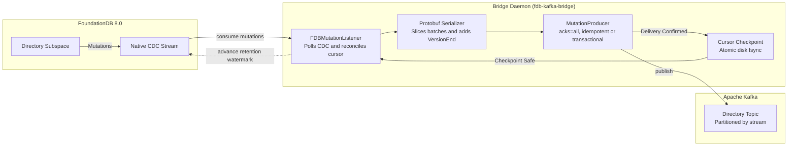

# Kafka-FDB-Streamline (`fdb-kafka-bridge`)

A change data capture (CDC) bridge connecting **FoundationDB 8.0** to **Apache Kafka**. It continuously streams live mutations from FoundationDB directory subspaces into Kafka topics with durable at-least-once delivery, strict ordering, and automated retention management.

---

## Architecture

The bridge runs as an autonomous daemon that coordinates between FoundationDB's native transaction log (TLog) CDC subsystem, Protobuf serialization, and a hardened Kafka producer:



### The Invariant Pipeline Step

Every batch follows an invariant, sequential lifecycle:
1. **Poll**: Consumes the next mutation reply from FoundationDB's CDC stream.
2. **Serialize**: Packages mutations into Protobuf envelopes (`FDBMutationRecord`), bounded by `max_record_bytes`, each marked with a `VersionEnd` boundary.
3. **Publish**: Writes records to Kafka with `acks=all` (and optional Kafka transactions).
4. **Checkpoint**: Atomically flushes and syncs the cursor position (`last_consumed_version`) to disk.
5. **Acknowledge**: Calls FDB's cumulative `acknowledge()`, moving the retention watermark so FDB can safely prune old transaction logs.

---

## Quickstart: Docker Demo

A complete end-to-end demo runs against live containerized FoundationDB 8.0 and Apache Kafka 3.9.0 instances:

```bash
# 1. Start the FoundationDB + Kafka stack
docker compose -f .devcontainer/docker-compose.yml up -d --build

# 2. Wait until FDB and Kafka accept connections, then install the bridge
docker compose -f .devcontainer/docker-compose.yml exec app \
  pip3 install --break-system-packages -e .

# 3. Run the live 10,000-mutation demonstration
docker compose -f .devcontainer/docker-compose.yml exec app \
  python3 demo/run_demo.py --count 10000
```

Give the stack a short moment after `up` before step 2 if FDB or Kafka are still starting.

### What happens:
1. Connects to FoundationDB using API version 800.
2. Starts the autonomous bridge daemon.
3. Commits 10,000 representative writes and atomic operations (`SET_VALUE`, `CLEAR_RANGE`, `ADD`, `MAX`, `MIN`, `SET_VERSIONSTAMPED_KEY`, etc.).
4. Streams CDC mutations into Kafka with `acks=all` and durable cursor checkpoints.
5. Consumes all records from Kafka and verifies byte-for-byte fidelity and sequence continuity.
6. Gracefully shuts down the daemon with queue drainage.

---

## Delivery Guarantees

The bridge guarantees **at-least-once delivery** and **strict commit-version ordering** within each directory stream.

* **Durability Knobs**: Enforces `acks=all`, `enable.idempotence=true`, `max.in.flight.requests.per.connection=5`, `enable.gapless.guarantee=true`, and `message.timeout.ms=0`. These settings cannot be weakened by callers.
* **Publishing Modes**:
  * **Idempotent Mode**: Delivers records in batches. Any delivery failure triggers a sticky error state that stops the pipeline, ensuring no messages are skipped or reordered.
  * **Transactional Mode**: Wraps batches in Kafka transactions (`transactional_id`). Downstream consumers using `isolation.level=read_committed` observe each FDB commit version atomically.
* **Crash & Recovery**:
  * If Kafka delivery or cursor checkpoint fails, FDB is **never acknowledged**. On restart, the bridge replays from the last durable cursor.
  * Each mutation envelope carries `fdb_version` and `sequence_no`, allowing downstream consumers to deduplicate or apply idempotent upserts.
  * If a crash occurs between cursor disk sync and FDB acknowledgement, the listener recovers by re-acknowledging the persisted cursor on startup before polling new records.

Kafka producer behavior and local verification are documented in the
[`Kafka producer specification`](docs/KAFKA-PRODUCER-SPEC.md).

---

## Limitations & Operational Considerations

### 1. Experimental FoundationDB Native CDC Support
* **Pre-release FDB 8.0**: Native CDC was introduced in FoundationDB 8.0.
* **API Version 800 Gate**: CDC requires initializing with `fdb.api_version(800)`. This version removes several legacy FDB features (such as Tenants, Metaclusters, Blob Granules, and Storage Cache Servers).
* **Upstream Python Bindings**: Native CDC Python bindings depend on Apple FoundationDB PRs [#13925](https://github.com/apple/foundationdb/pull/13925) and [#13971](https://github.com/apple/foundationdb/pull/13971), which are open upstream.

### 2. Transaction Log (TLog) Disk Retention
* **Indefinite Retention**: FoundationDB retains transaction logs for active CDC streams until explicitly acknowledged by the consumer.
* **Cluster Stalling Risk**: If the bridge daemon is stopped or falls behind indefinitely, TLog disk usage will grow. When disk space drops to **5% free**, FoundationDB halts commits cluster-wide. Production deployments must alert on consumer lag and TLog disk utilization.

### 3. Oversized Commit Versions
* If a single FDB commit version exceeds the CDC buffer limit, FDB raises `server_overloaded` (1211). Because native CDC cannot skip versions, oversized commit versions must be cleared or the stream re-registered.

### 4. Ordering Scope
* Monotonic ordering is preserved per registered stream (directory subspace). All records for a stream share a partition key (`stream_name`). Cross-directory transactions are not atomic across separate Kafka topics without upstream stream merging.

---

## Getting Started & Development

### Requirements
* Python 3.12+
* FoundationDB client library (`libfdb_c.so` on Linux, `libfdb_c.dylib` on macOS)

### Local Setup

```bash
# Setup virtual environment and dev tools
make setup && source .venv/bin/activate

# Code formatting and linting (ruff + black)
make lint

# Run unit and property tests
make test
```

Requires Python 3.12. Commits must be signed — see [Signed commits](docs/conventions.md#signed-commits).

### Installation

```bash
pip install .
```

Installs the `fdb-kafka-bridge` distribution, which provides the import packages `fdb_kafka_bridge` (subpackages `bridge`, `cdc`, `kafka`, `serialization`) and `fdbkafka` (generated Protobuf).

`libfdb_c` is a system requirement that pip does not install. The `foundationdb` Python package depends on it at runtime: `import fdb` succeeds without it, but `fdb.api_version()` raises `Unable to locate the FoundationDB API shared library!`. Install the client library from the [FoundationDB release](https://github.com/apple/foundationdb/releases) that matches `FDB_VERSION` in the [`Dockerfile`](Dockerfile), which shows the Linux setup.

### Contributing

Repo layout, branching, code style and PR workflow: [`docs/conventions.md`](docs/conventions.md). Coding-agent guidance: [`AGENTS.md`](AGENTS.md).

---

## Further Reading

* [`Proposal.md`](Proposal.md) — Architecture motivation, design rationale, and background.
* [`docs/INDEX.md`](docs/INDEX.md) — Map of all project specifications and deep dives.
* [`docs/CDC-DEEP-DIVE.md`](docs/CDC-DEEP-DIVE.md) — Comprehensive analysis of FDB native CDC mechanics and limitations.
* [`docs/KAFKA-PRODUCER-SPEC.md`](docs/KAFKA-PRODUCER-SPEC.md) — Producer durability contract and local Kafka verification.
* [`docs/conventions.md`](docs/conventions.md) — Repository layout, branching rules, and PR requirements.
* [`demo/README.md`](demo/README.md) — Live Docker demo details and CLI flags.
