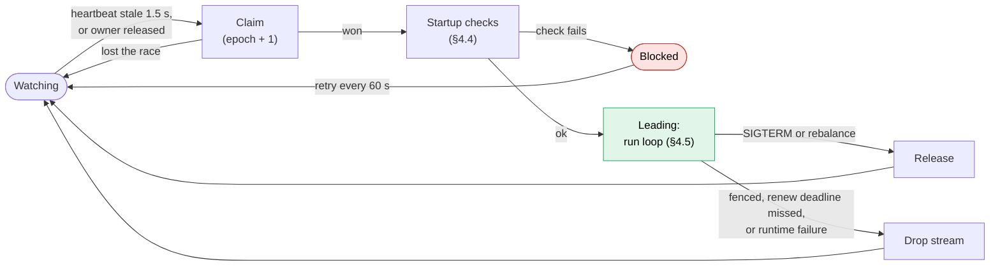
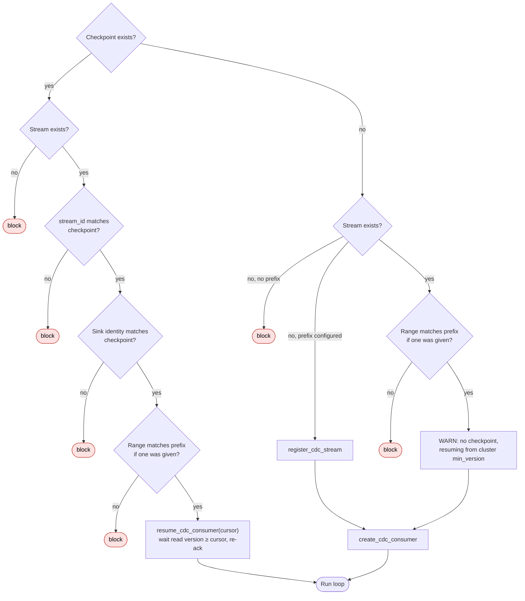
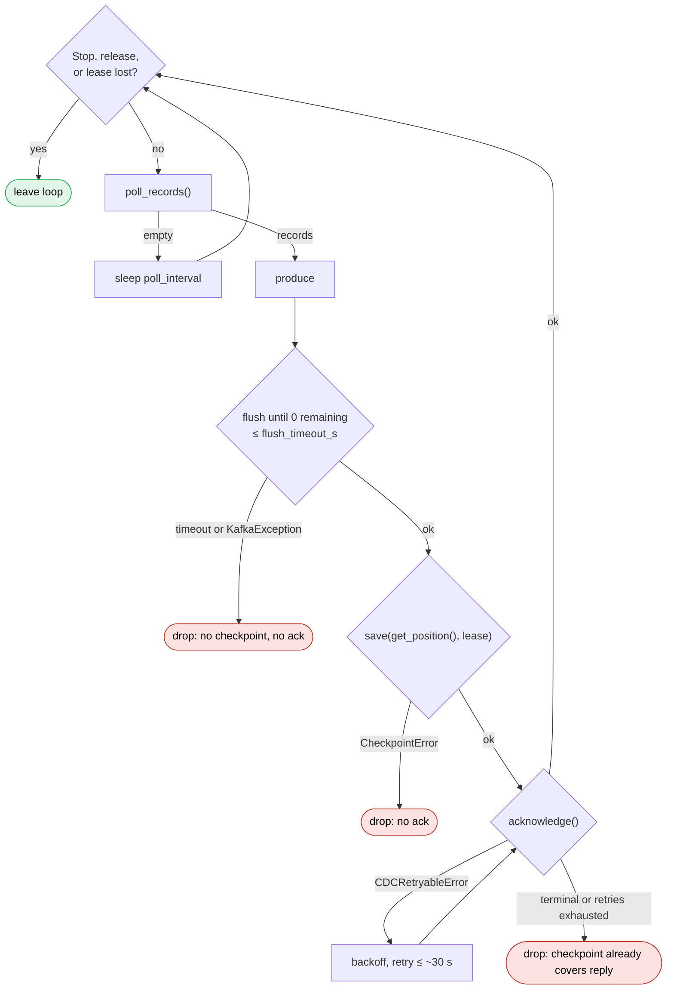

# Checkpoint Spec

Contract for durably checkpointing the CDC cursor in FoundationDB, and for running a pool
of bridge pods that fail a stream over to another pod within 3 seconds.

Trello: [FoundationDB Commit Version Checkpointing](https://trello.com/c/QmqdoJy5).
Terms: [CDC consumer spec §1](CDC-CONSUMER-SPEC.md#1-scope--rules).
Related: [Daemon Entrypoint & CLI Configuration Runner](https://trello.com/c/5t718fA3),
Wire FDB Listener into Kafka Mutation Producer.

> **Status:** spec only. Implementation waits for PR #18 (the real `MutationProducer`
> with `flush()`) and for the daemon branch to move onto it ("Wire FDB Listener into Kafka
> Mutation Producer", "Daemon Entrypoint & CLI Configuration Runner"). The 3 s failover
> target also needs a lower `CDC_PROXY_CONSUME_POLL_TIMEOUT` default in FDB (§4.3).

## 1. Guarantees

At-least-once delivery. Consumers drop any record whose commit version is ≤ the highest
seen for its stream. A replay can land after newer records, so exact-match dedup isn't
enough.

The checkpoint is an identity and integrity guard, not the only record of position.
Every ack advances the stream's `min_version` in the cluster, and a fresh consumer on an
acked stream starts at last ack + 1
([CDC deep dive §1.6](CDC-DEEP-DIVE.md#16-baseline-snapshot-and-handoff-)). The
checkpoint is written before the ack, so it is at most one reply ahead of the cluster.
Losing it costs at most one duplicated reply, never data.

What it adds is detection of a stream that is no longer the one this daemon consumed:

| Hazard | Without a checkpoint | With a checkpoint |
|---|---|---|
| Stream removed and re-registered under the same name | Fresh consumer starts at the new registration. Mutations committed in between are skipped silently. | `stream_id` mismatch, stream blocked |
| Another consumer acked the stream | Fresh consumer starts past the foreign ack. Its replies never reach Kafka. | Resume at the stored cursor fails with `transaction_too_old` instead of skipping silently |
| Two deployments on one stream, different sinks (topic or Kafka cluster) | Each sink misses every version the other deployment acked. Silent loss. | Sink mismatch, stream blocked before the second deployment acks |

## 2. Storage

- **Location:** a directory-layer directory, opened with `create_or_open` once at startup
  and its prefix cached. The path is configurable, default
  `("fdb-kafka-bridge", "checkpoints")`. The directory layer only provides namespacing;
  durability comes from FDB itself.
- **Keys:** three per stream, all under the same directory. The stream name is known
  before registration, unlike `stream_id`, so startup can find them first.

  | Key | Value | Written by |
  |---|---|---|
  | `dir.pack((stream_name,))` | checkpoint | the stream's leader, in `save()` |
  | `dir.pack((stream_name, "owner"))` | `(format_version, epoch, owner_id)` | claim and release (§4.2) |
  | `dir.pack((stream_name, "hb"))` | 8-byte counter | the leader's heartbeat, every 250 ms |

- **Checkpoint value:** tuple-packed
  `(format_version, stream_id, last_consumed_version, kafka_cluster_id, topic)`, where
  `format_version` is `1`. A decoder rejects any other format version.
- **Sink identity:** `(kafka_cluster_id, topic)`. The cluster id comes from broker
  metadata (`list_topics().cluster_id`), not `bootstrap.servers`, which can name one
  cluster under several addresses. Acks advance one per-stream frontier
  (`min_version`) whatever sink the acking daemon wrote to, so a checkpoint is only
  valid for the sink that received everything up to its cursor.
- **Overlap guard:** writes to these keys must never be captured as mutations. At
  startup, if any key above or the directory-layer metadata (`\xfe`) falls inside any
  registered range of a configured stream, the pod exits 3. Check `begin_key`/`end_key`
  now, and `ranges` once #13971 lands.

## 3. Write semantics

`save(stream_name, cursor, lease)` is one `@fdb.transactional` function: read the stored
records, apply the guards, then `set`. It is optimistic, not a lock. A concurrent writer
conflicts and the transaction retries. Rows are checked in order. The owner row comes
first, so a pod that lost the stream can never write. The sink row comes next, so a second
deployment on another sink is stopped before any version comparison.

| Stored record, relative to the new cursor | Result |
|---|---|
| owner key is not this pod's `(epoch, owner_id)` | `CheckpointFencedError` |
| no checkpoint | `set` |
| different sink identity | `CheckpointSinkMismatchError(stored, attempted)` |
| same `stream_id`, older version | `set` |
| same `stream_id`, same version | No-op success, no `set`. Makes a retry after `commit_unknown_result` safe. |
| same `stream_id`, newer version | `CheckpointRegressionError(stored, attempted)` |
| different `stream_id` | `CheckpointStreamMismatchError(stored, attempted)` |

The owner check is what makes a takeover safe. A claim writes the owner key and `save()`
reads it, so FDB lets only one of the two commit. If the claim wins, the old leader's
`save()` retries, sees the new epoch, and raises. If `save()` wins, the new leader loads
that checkpoint after its claim.

Retries use the standard loop with `timeout_s=5` and `retry_limit=10`, both configurable.
Exhausting either raises `CheckpointWriteError`.

`CheckpointError` is the base, separate from `CDCError`. Every subclass stops the stream
without acking (§4.5). The ack has not happened yet, so the cost is duplicates, never
loss.

The sink guard only works if every pod on a stream reads the same keys, so the directory
path (§2) must be the same for all deployments of a stream. Two deployments with
different paths bypass every guard here, including the owner check.

Changing the sink on purpose (new topic, new cluster, DR cut-over) means
`delete(stream_name)` first. The new sink then starts at last ack + 1 with no backfill.
Backfilling it needs a baseline snapshot
([deep dive §1.6](CDC-DEEP-DIVE.md#16-baseline-snapshot-and-handoff-)).

## 4. Failover

### 4.1 How it works

A pool of identical bridge pods serves a configured list of streams. Every pod has the
same list.

Each stream has exactly one **leader**, the only pod allowed to consume it. The FDB CDC
proxy rejects a second consumer on a stream, so a stream can't be split across pods.
More streams means more throughput. More pods means more spare capacity.

A pod leads some streams and watches the rest. The leader proves it is alive by bumping
the stream's `hb` key every 250 ms. Every other pod reads those keys every 200 ms. When a
stream's heartbeat stops for 1.5 s, one of them claims it, which bumps the stream's
`epoch`. From then on the old leader's `save()` fails (§3), so it can never checkpoint or
ack again.

There is no separate supervisor. FDB decides who leads, and the platform only has to keep
pods running.



### 4.2 Lease transactions

`owner_id` is a random `uuid4` each pod makes at startup. `epoch` only goes up. Release
sets `owner_id` to None and keeps the epoch.

```python
@fdb.transactional
def claim(tr, s, me, seen_owner, seen_hb) -> int | None:
    owner, hb = read(tr, s)                 # non-snapshot: a renew mid-claim aborts it
    if owner.id == me:
        return owner.epoch                  # retry after commit_unknown_result
    if owner.id is not None and (owner, hb) != (seen_owner, seen_hb):
        return None                         # leader renewed after all
    tr[owner_key(s)] = pack((1, owner.epoch + 1, me))
    return owner.epoch + 1

@fdb.transactional
def renew(tr, me, leases) -> list[bytes]:   # one transaction for all of a pod's streams
    lost = [s for s, epoch in leases if unpack(tr[owner_key(s)]) != (1, epoch, me)]
    for s, _ in leases:
        if s not in lost:
            tr.add(hb_key(s), ONE)
    return lost

@fdb.transactional
def release(tr, s, me, epoch) -> None:
    if unpack(tr[owner_key(s)]) == (1, epoch, me):
        tr[owner_key(s)] = pack((1, epoch, None))
```

Heartbeats live in their own key so the leader's renews never conflict with its own
`save()`. Two pods claiming the same stream at once is safe: both write the owner key, and
FDB commits only one.

### 4.3 Timings

| Setting | Value | Why |
|---|---|---|
| Heartbeat (renew) period | 250 ms, 200 ms txn timeout | A takeover needs ~6 missed renews. |
| Watch poll period | 200 ms | One range read over all owner and hb keys. |
| Takeover | 1.5 s of unchanged heartbeat | |
| Leader deadline | 1.25 s without a successful renew | Under 1.5 s, so the old leader stops first. |
| First consume after a claim | retry `client_invalid_operation` every 100 ms for 1.5 s | |
| Claim delay | 50 ms per stream the pod already leads, max 300 ms | Spreads streams across pods (§4.6). |
| `CDC_PROXY_CONSUME_POLL_TIMEOUT` | ≤ 1 s, set in FDB | Must not exceed the takeover time. |

The last row is an FDB server setting. While a consumer is waiting on an idle stream, the
CDC proxy keeps that request open for this long. Until it expires, no other consumer can
take the stream. It is 5 s today, which alone breaks a 3 s target. The FDB maintainers have
agreed to lower the default.

With that setting at 1 s or less, a dead leader's request expires before the 1.5 s
takeover finishes, so the new leader's first consume normally works right away.

| Event | Expected failover |
|---|---|
| Pod crash, SIGKILL, node loss | ~2 s: 1.5 takeover + 0.2 poll + 0.3 claim delay + claim |
| Rollout or SIGTERM | ~1 s: the leader releases, and the waiting pods see it at once |
| Leader paused longer than 1.5 s | ~2 s. The old leader finds it lost the stream on its next renew. |
| FDB recovery | No takeover (§4.6) |

These are estimates from the timings. Measure them before relying on them (§6).

### 4.4 Startup checks

**Pod startup.** Open the FDB client and the directory, call `list_cdc_streams()`, and
run the overlap guard (§2) for every configured stream. A failure exits 3, because it is a
configuration problem that affects every stream. Then start watching.

**Stream startup.** Runs after each successful claim, before consuming. A failed check
**blocks** the stream: the pod releases it, logs an error, raises the `stream_blocked`
metric, and retries the checks every 60 s. It does not exit, because that would drop every
other stream the pod leads. Every pod blocks the same stream for the same reason, so an
operator has to fix it. Alert on `stream_blocked`; an unconsumed stream pins FDB storage
(§4.9).



Every check runs before any registration or write, so a blocked stream has no side
effects beyond the owner key.

### 4.5 Run loop

One per leading stream, each on its own thread.



**Dropping a stream** means: cancel the consume future, destroy the consumer, and go back
to watching. Cancelling matters. On an idle stream the FDB client quietly reopens its
consume request, so a consumer that is only abandoned keeps the stream locked.

**Losing the lease.** The renew loop drops a stream when `renew()` reports it lost, or
when no renew has succeeded for 1.25 s. The run loop also checks before each poll and
before each flush.

**Shutdown (SIGTERM).** For each leading stream: stop polling, finish the reply already
polled through ack, release the lease. Then exit 0. Pods watching the owner key take over
within about a second.

### 4.6 Watching, claiming and spreading streams

Each pod, every 200 ms, reads all owner and hb keys in one range read and holds an FDB
watch on each owner key. Per stream it remembers the last value seen and when it changed.

- **Claim at once** if the owner is None, after the claim delay.
- **Claim after 1.5 s** if the value hasn't changed across good reads, plus the claim
  delay.
- **Reset the timer** whenever the value changes, a read fails, or two good reads are more
  than 400 ms apart.

The reset rule prevents takeovers during an FDB recovery. While FDB recovers, no pod can
read or write. Afterwards the watching pods need another 1.5 s of clean reads, and the
leader renews well within that. Recovery also jumps FDB's version by ~100 s, which is why
timing uses each pod's local clock, not FDB versions.

**Spreading.** Without it, the first pod to start claims everything.

- The claim delay favours pods that lead fewer streams.
- No pod leads more than `ceil(M / (N - 1))` streams, where M is the number of streams and
  N the configured pod count. The survivors can then absorb one lost pod.
- A pod leading more than `ceil(M / N)` streams releases one extra stream at a time, at
  most one every 5 s, until it is under that limit. This moves streams onto a pod that just
  started without causing a burst of failovers.

### 4.7 Crash points

What the next leader sees when the current one dies or loses the lease at each step for
reply `R`:

| Dies during / after | Stored checkpoint | Next leader resumes from | Effect for `R` |
|---|---|---|---|
| poll or produce | before `R` | before `R` | Re-polled and re-produced. Partial sends are duplicated. |
| flush | before `R` | before `R` | Delivered records are duplicated. |
| checkpoint commit (`commit_unknown_result`) | before or after `R` | whichever committed | Duplicated if it didn't commit, nothing if it did. |
| lease lost before `save` | before `R` | before `R` | `save` raises `CheckpointFencedError`. `R` is duplicated. |
| after checkpoint, before or during ack | after `R` | after `R` | None. Resume re-acks the cursor. |
| after ack | after `R` | after `R` | None. |
| — (checkpoint lost or deleted, or directory path changed) | none | last ack + 1 (fresh consumer) | At most one reply duplicated. |

No row loses data. The worst case is redelivering one reply's records.

### 4.8 Exit codes

A pod exits only for problems that affect every stream. Stream-level problems drop or
block the stream (§4.4, §4.5).

| Code | Meaning | Platform |
|---|---|---|
| 0 | Clean shutdown (SIGINT/SIGTERM), all leases released | Stays down if stopped on purpose |
| 1 | Unexpected failure of the pod itself | Restart with backoff |
| 2 | Config or usage error | Crash loop |
| 3 | Overlap guard failed (§2) | Crash loop, alert on the code |

### 4.9 Deployment requirements

- **Kubernetes:** a Deployment with `replicas: N`, N ≥ 2, and pod anti-affinity so no two
  pods share a node. Size N so that N − 1 pods can lead every stream.
  `terminationGracePeriodSeconds ≥ 60` covers the flush deadline plus the ack retry.
  Rolling updates are safe, because a leaving pod releases its streams.
- **Stopping the bridge** means scaling to 0. Deleting one pod only moves its streams to
  the others.
- **Docker Compose:** `restart: unless-stopped`, `scale` ≥ 2.
- **systemd:** `Restart=on-failure`, `RestartPreventExitStatus=2 3`, on at least two
  hosts.
- **FDB:** `CDC_PROXY_CONSUME_POLL_TIMEOUT` ≤ 1 s (§4.3).
- **Readers:** every reader applies the §1 version watermark. No compacted topics and no
  readers that keep the last value per key by offset until the transactional producer
  lands.
- **Alerts:** `stream_blocked`, exit 3, and restart loops. A stream nobody consumes stops
  acking, and unacked history fills the FDB TLog disk queue. Left long enough, that trips
  Ratekeeper and halts every commit on the cluster
  ([deep dive L3](CDC-DEEP-DIVE.md#3-known-limitations-and-gaps-deliverable-3)).

Node loss needs no manual step. The pod on the lost node stops renewing, and another pod
claims its streams after 1.5 s. If that node is only cut off from the network and its pod
is still running, the pod stops itself at 1.25 s and its checkpoint writes fail anyway.

### 4.10 Duplicates and the old leader

The owner check fences the checkpoint and the ack. It does not fence Kafka. Between losing
the lease and noticing, an old leader can still produce, for up to 250 ms in the normal
case. Together with replaying the last uncheckpointed reply, this means every failover can
duplicate some records, and a pool with more pods has more failovers in total.

Readers handle this with the §1 watermark. A transactional producer would stop the old
leader's writes at the Kafka side. Whether to require it before the pool ships is open
(§7).

## 5. Store API

`src/cdc/checkpoint.py`, exported from `src.cdc`:

```python
class CheckpointStore:
    def __init__(
        self,
        client: FDBClient,
        *,
        sink: SinkIdentity,                             # (kafka_cluster_id, topic), §2
        path: tuple[str, ...] = ("fdb-kafka-bridge", "checkpoints"),
        timeout_s: float = 5.0,
        retry_limit: int = 10,
    ) -> None: ...
    def open(self) -> None: ...                         # create_or_open, cache prefix
    def key_range(self) -> tuple[bytes, bytes]: ...     # for the overlap guard
    def load(self, stream_name: bytes) -> CdcCursor | None: ...
    def save(self, stream_name: bytes, cursor: CdcCursor, lease: Lease) -> None: ...  # §3
    def delete(self, stream_name: bytes) -> None: ...   # operator recovery
```

`src/cdc/lease.py`, sharing the store's directory:

```python
@dataclass(frozen=True)
class Lease:
    stream_name: bytes
    epoch: int
    owner_id: bytes

class LeaseStore:
    def read_all(self) -> dict[bytes, LeaseState]: ...  # one range read, §4.6
    def claim(self, stream_name: bytes, seen: LeaseState) -> Lease | None: ...
    def renew(self, leases: list[Lease]) -> list[Lease]: ...  # returns the lost ones
    def release(self, lease: Lease) -> None: ...
    def watch(self, stream_name: bytes) -> Future: ...  # fires on owner change
```

Whether the binding's native `CdcCursor` can be constructed from Python is still to be
verified. If it can't, `load` returns a dataclass exposing `stream_id` and
`last_consumed_version`, which `FDBClient.resume_cdc_consumer` already validates
(`src/cdc/client.py`).

`SinkIdentity` is a frozen dataclass of `kafka_cluster_id: str` and `topic: str`. The
daemon builds it at startup from the configured topic and a new
`MutationProducer.cluster_id()`, which reads `list_topics(timeout=...).cluster_id` and
raises if the broker reports none.

`resolve_startup(client, store, stream_name, key_range) -> (cursor | None, register)` lives
in `src/bridge/` and runs the §4.4 stream checks. Its decision core takes plain values
(checkpoint, stream list, configured prefix, sink identity) so every branch can be
unit-tested. The pod loop (renew, watch, claim, spread) also lives in `src/bridge/`, with
the clock injected so timing rules can be unit-tested.

## 6. Tests

| Area | Kind | Location |
|---|---|---|
| Value encode/decode | Unit | `tests/cdc/` |
| §3 guards, deterministic stale writer (save V2 then V1), sink mismatch (two stores, same path, different sinks), retry exhaustion via a tiny timeout | Live FDB, throwaway directory per test | `tests/cdc/` |
| §4.2 claim vs claim, claim vs renew, claim vs `save` (fenced), release, `commit_unknown_result` retries | Live FDB | `tests/cdc/` |
| §4.6 takeover timer, reset on failed read, claim delay, stream cap, rebalancing | Unit, fake clock and fake `LeaseStore` | `tests/bridge/` |
| §4.5 order, drop paths, SIGTERM mid-reply, release on shutdown, first-consume retry, consumer cancelled on drop | Unit: fake listener, producer and store sharing one call log, failure injected at each step | `tests/bridge/` |
| §4.7 crash points, one case per row | Live FDB: real CDC and store, in-memory producer. A crash is a raise at step N plus abandoning the listener; a second pod resumes. | `tests/bridge/` |
| §4.4 every branch, plus no write before a block | Unit, with a store fake that records writes | `tests/bridge/` |
| §4.4 overlap, registration idempotent by name, range mismatch | Live FDB | `tests/bridge/` |
| §1 assumptions: fresh consumer starts at last ack + 1; re-registration mints a new `stream_id`; resume after a foreign ack fails with `transaction_too_old` | Live FDB, required | `tests/cdc/` |
| Proxy consume request expires within `CDC_PROXY_CONSUME_POLL_TIMEOUT` after an abandoned consume | Live FDB, required once the lower default lands | `tests/cdc/` |
| Renew thread keeps its 250 ms period while consumer threads wait in `consume()` | Live FDB, required | `tests/bridge/` |
| Failover time: SIGKILL a leader, measure until the new leader's first ack | Live FDB, two pods, reports p50/p99 | `tests/bridge/` |

No test mocks FDB transactions. Live tests carry the `integration` marker and are skipped
unless `FDB_CDC_INTEGRATION=1`.

**CI:** a `test-checkpointing` job in `Container-setup.yml` runs
`tests/cdc/test_checkpoint*.py`, `tests/cdc/test_lease*.py` and `tests/bridge/` inside the
`fdb-cdc:ci` image against its real FDB cluster, the same way `test-cdc-mutations` does.

**Coverage:** `--cov-branch --cov-fail-under=100` on `src/cdc/checkpoint.py` and
`src/cdc/lease.py`. `# pragma: no cover` needs a one-line reason. The resolver and pod
loop are reported but not gated until the daemon lands. If 100% would need a
non-deterministic test, the gate drops to 90% and is re-evaluated. A flaky test is never
accepted to hold the gate.

**Out of scope:** an end-to-end test with real Kafka and SIGKILL, which needs Kafka in CI.

## 7. Open questions and not yet specified

- **Python's global lock during `consume().wait()`.** If the wait holds it, the renew
  thread stalls and leaders drop their streams over and over. Test this first (§6).
- **False takeovers.** 1.5 s is tight. Slow FDB commits or long Python pauses could hand a
  healthy stream to another pod. That is safe, but each one costs a ~2 s pause and some
  duplicates. Measure p99 renew latency in staging before fixing the value.
- **Transactional producer.** Decide whether the pool ships with it or relies on the §1
  watermark alone (§4.10).
- **Streams per pod.** Kafka producer throughput and memory set the limit. Needs a
  benchmark.
- **Ordered-stream partitions.** If they can be consumed one partition per pod, they
  would scale a single stream without new key ranges. Unverified.
- **CDC proxy failover.** The 3 s target covers bridge pods only, not the CDC proxy moving
  to another FDB process.
- **Coalesced checkpointing:** checkpoint and ack every N replies or T seconds.
- **Atomic-MAX layout:** store the version under its own key, written with atomic `MAX`, if
  per-reply checkpoint latency is a bottleneck. This gives up the §3 guards.
- **`reset-checkpoint` CLI:** wraps `CheckpointStore.delete()`.
- **Reference deployment configs:** tracked on "Reference Deployment Configs (k8s,
  Compose, systemd)".

## 8. Acceptance criteria

These replace the original criteria on the Trello card. They correct the original's
version-only checkpoint, its "+1" resume, its `\xff` subspace, and its ack-before-checkpoint
order.

- [ ] The checkpoint is the full cursor `(stream_id, last_consumed_version)` plus the
      sink identity `(kafka_cluster_id, topic)`, stored per §2 with the owner and hb keys.
      Never under `\xff`.
- [ ] A pod exits 3 if any of its keys or the directory metadata overlaps a configured
      stream's range.
- [ ] `save()` follows §3: one optimistic transaction, owner check first, the
      equal-version no-op, and `CheckpointError` subclasses for fencing, sink mismatch,
      regression, `stream_id` mismatch and retry exhaustion.
- [ ] Claim, renew and release follow §4.2, with the §4.3 timings as configurable
      defaults.
- [ ] Each leading stream runs the §4.5 loop: poll → produce → flush →
      `save(get_position(), lease)` → ack. A flush, checkpoint or ack failure drops the
      stream without acking. Dropping cancels the consumer.
- [ ] A leader drops a stream when its lease is lost or no renew has succeeded for
      1.25 s. SIGTERM finishes the polled reply, releases every lease, and exits 0.
- [ ] Pods take over per §4.6, including the reset rule, the claim delay, the stream cap
      and one-at-a-time rebalancing.
- [ ] Stream startup follows §4.4: resume the stored cursor as-is, with no "+1". A failed
      check blocks the stream with no prior writes and raises `stream_blocked`.
- [ ] `CheckpointStore`, `LeaseStore` and `resolve_startup()` match §5.
- [ ] The tests in §6 run in the `test-checkpointing` CI job inside the FDB container,
      with 100% branch coverage on `checkpoint.py` and `lease.py`.
- [ ] Measured SIGKILL failover p99 is under 3 s on the reference deployment.
