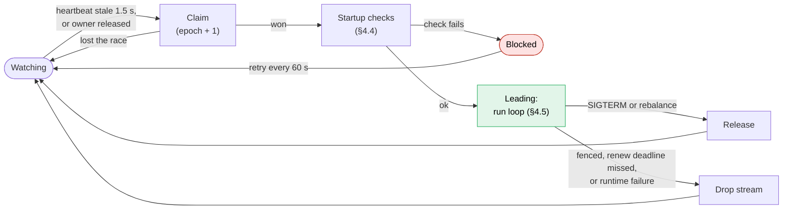
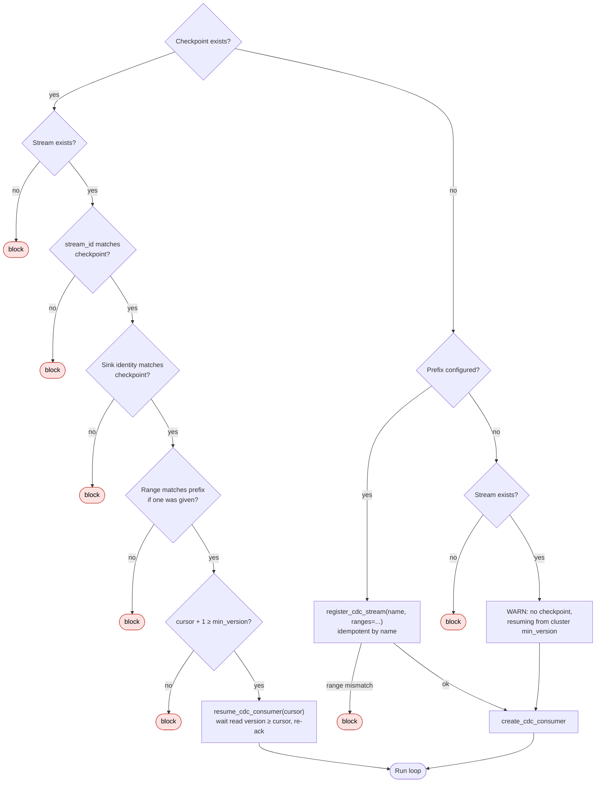
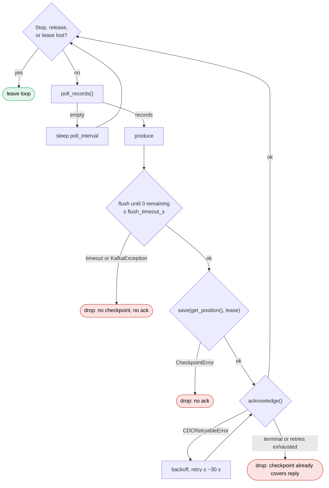

# Checkpoint Spec

Contract for durably checkpointing the CDC cursor in FoundationDB, and for running a pool
of bridge pods that fail a stream over to another pod within 3 seconds.

Trello: [FoundationDB Commit Version Checkpointing](https://trello.com/c/QmqdoJy5).
Terms: [CDC consumer spec §1](CDC-CONSUMER-SPEC.md#1-scope--rules).
Related: [Daemon Entrypoint & CLI Configuration Runner](https://trello.com/c/5t718fA3),
Wire FDB Listener into Kafka Mutation Producer.

> **Status:** spec only. Implementation waits for PR #18 (the real `MutationProducer`
> with `flush()`) and for the daemon branch to move onto it ("Wire FDB Listener into Kafka
> Mutation Producer", "Daemon Entrypoint & CLI Configuration Runner"). The 3 s failover
> target also needs `CDC_PROXY_CONSUME_POLL_TIMEOUT` lowered in FDB (§4.3). Details may
> change during implementation. §9 records which FDB features were reviewed and rejected.

## 1. Guarantees

At-least-once delivery. Consumers drop any record whose commit version is ≤ the highest
seen for its stream. A replay can land after newer records, so exact-match dedup isn't
enough.

The checkpoint is an identity and integrity guard, not the only record of position.
Every ack advances the stream's `min_version` in the cluster, and a fresh consumer on an
acked stream starts at last ack + 1
([CDC deep dive §1.6](CDC-DEEP-DIVE.md#16-baseline-snapshot-and-handoff-)). The
checkpoint is written before the ack, so it is at most one reply ahead of the cluster.
Losing it costs at most one duplicated reply, never data.

What it adds is detection of a stream that is no longer the one this daemon consumed:

| Hazard | Without a checkpoint | With a checkpoint |
|---|---|---|
| Stream removed and re-registered under the same name | Fresh consumer starts at the new registration. Mutations committed in between are skipped silently. | `stream_id` mismatch, stream blocked |
| Another consumer acked the stream | Fresh consumer starts past the foreign ack. Its replies never reach Kafka. | Startup blocks the stream when `cursor + 1 < min_version` (§4.4). `transaction_too_old` from the server is the backstop. |
| Two deployments on one stream, different sinks (topic or Kafka cluster) | Each sink misses every version the other deployment acked. Silent loss. | Sink mismatch, stream blocked before the second deployment acks |

## 2. Storage

- **Location:** a plain `fdb.Subspace`, configurable, default
  `("fdb-kafka-bridge", "checkpoints")`. It needs no startup transaction. Avoiding prefix
  collisions is our job, since nothing allocates the prefix.
- **Keys:** three per stream, all under the same subspace. The stream name is known
  before registration, unlike `stream_id`, so startup can find them first.

  | Key | Value | Written by |
  |---|---|---|
  | `sub.pack((stream_name,))` | checkpoint | the stream's leader, in `save()` |
  | `sub.pack((stream_name, "owner"))` | `(format_version, epoch, owner_id)` | claim and release (§4.2) |
  | `sub.pack((stream_name, "hb"))` | 8-byte counter | the leader's heartbeat, every 250 ms |

- **Checkpoint value:** tuple-packed
  `(format_version, stream_id, last_consumed_version, kafka_cluster_id, topic)`, where
  `format_version` is `1`. A decoder rejects any other format version.
- **Sink identity:** `(kafka_cluster_id, topic)`. The cluster id comes from broker
  metadata (`list_topics().cluster_id`), not `bootstrap.servers`, which can name one
  cluster under several addresses. Acks advance one per-stream frontier
  (`min_version`) whatever sink the acking daemon wrote to, so a checkpoint is only
  valid for the sink that received everything up to its cursor.
- **Overlap guard:** writes to these keys must never be captured as mutations. At
  startup, if any key above falls inside any registered range of a configured stream, the
  pod exits 3. Check `CdcStreamInfo.ranges`, because `begin_key` raises `ValueError` on a
  multi-range stream. FDB does no such check for us.

## 3. Write semantics

`save(stream_name, cursor, lease)` is one `@fdb.transactional` function: read the stored
records, apply the guards, then `set`. It is optimistic, not a lock. A concurrent writer
conflicts and the transaction retries. Rows are checked in order. The owner row comes
first, so a pod that lost the stream can never write. The sink row comes next, so a second
deployment on another sink is stopped before any version comparison.

| Stored record, relative to the new cursor | Result |
|---|---|
| owner key is not this lease's `(epoch, owner_id)` | `CheckpointFencedError` |
| no checkpoint | `set` |
| different sink identity | `CheckpointSinkMismatchError(stored, attempted)` |
| same `stream_id`, older version | `set` |
| same `stream_id`, same version | No-op success, no `set`. Makes a retry after `commit_unknown_result` safe. |
| same `stream_id`, newer version | `CheckpointRegressionError(stored, attempted)` |
| different `stream_id` | `CheckpointStreamMismatchError(stored, attempted)` |

The owner check is what makes a takeover safe. A claim writes the owner key and `save()`
reads it, so FDB lets only one of the two commit. If the claim wins, the old leader's
`save()` retries, sees the new epoch, and raises. If `save()` wins, the new leader loads
that checkpoint after its claim.

Retries use the `@fdb.transactional` loop. The decorator takes no timeout or retry
arguments, and passing it a pre-configured `Transaction` skips both commit and retry. So
limits are set once on the database, when `FDBClient` opens it, with
`db.options.set_transaction_timeout(5000)` and `set_transaction_retry_limit(10)`, both
configurable. This also bounds claim, release, `load` and `read_all`. The options are
process-wide, because `fdb.open` caches per cluster file. The timeout covers all attempts,
and a limit of 10 means 11 attempts. Exhausting either raises `CheckpointWriteError`.

A timed-out commit (1031) is not retried and may still land later, unlike
`commit_unknown_result`, where the client first confirms the commit is no longer in flight.
Dropping without an ack handles this: owner-key conflicts reject a late `save()` after a
claim. Never set `causal_write_risky`.

`CheckpointError` is the base, separate from `CDCError`. Every subclass stops the stream
without acking (§4.5). The ack has not happened yet, so the cost is duplicates, never
loss.

The sink guard only works if every pod on a stream reads the same keys, so the subspace
prefix (§2) must be the same for all deployments of a stream. Two deployments with
different prefixes bypass every guard here, including the owner check.

Changing the sink on purpose (new topic, new cluster, DR cut-over) means
`delete(stream_name)` first. The new sink then starts at last ack + 1 with no backfill.
Backfilling it needs a baseline snapshot
([deep dive §1.6](CDC-DEEP-DIVE.md#16-baseline-snapshot-and-handoff-)).

## 4. Failover

### 4.1 How it works

A pool of identical bridge pods serves a configured list of streams. Every pod has the
same list.

Each stream has exactly one **leader**, the only pod allowed to consume it. The lease is
the real exclusion. The FDB CDC proxy only rejects a concurrent consume RPC, so nothing is
locked during produce, flush or save, and a stale ack still lands. More streams means more
throughput. More pods means more spare capacity.

A pod leads some streams and watches the rest. The leader proves it is alive by bumping
the stream's `hb` key every 250 ms. Every other pod reads those keys every 200 ms. When a
stream's heartbeat stops for 1.5 s, one of them claims it, which bumps the stream's
`epoch`. From then on the old leader's `save()` fails (§3), so it can't start another
checkpoint-then-ack cycle. An ack already past its `save()` can still land after a claim.
This loses no data.

There is no separate supervisor. FDB decides who leads, and the platform only has to keep
pods running.



### 4.2 Lease transactions

`owner_id` is a random `uuid4` made per claim attempt and kept across that attempt's
transaction retries, so `owner.id == me` can only mean a retry after
`commit_unknown_result`. A pod that dropped a stream and claims it again gets a new
`owner_id` and a new epoch, which fences any thread left over from its earlier tenure.
`epoch` only goes up. Release sets `owner_id` to None and keeps the epoch.

```python
@fdb.transactional
def claim(tr, s, me, seen_owner, seen_hb) -> int | None:
    owner, hb = read(tr, s)                 # non-snapshot: a renew mid-claim aborts it
    if owner.id == me:
        return owner.epoch                  # retry after commit_unknown_result
    if owner.id is not None and (owner, hb) != (seen_owner, seen_hb):
        return None                         # leader renewed after all
    tr[owner_key(s)] = pack((1, owner.epoch + 1, me))
    return owner.epoch + 1

@fdb.transactional
def renew(tr, leases) -> list[Lease]:       # one transaction for all of a pod's streams
    lost = [l for l in leases if unpack(tr[owner_key(l.stream_name)]) != (1, l.epoch, l.owner_id)]
    for l in leases:
        if l not in lost:
            tr.add(hb_key(l.stream_name), ONE)
    return lost

@fdb.transactional
def release(tr, lease) -> None:
    s = lease.stream_name
    if unpack(tr[owner_key(s)]) == (1, lease.epoch, lease.owner_id):
        tr[owner_key(s)] = pack((1, lease.epoch, None))
```

Heartbeats live in their own key so the leader's renews never conflict with its own
`save()`. Two pods claiming the same stream at once is safe: both write the owner key, and
FDB commits only one.

### 4.3 Timings

| Setting | Value | Why |
|---|---|---|
| Heartbeat (renew) period | 250 ms, 200 ms txn timeout | A takeover needs ~6 missed renews. |
| Watch poll period | 200 ms | One range read over all owner and hb keys. |
| Takeover | 1.5 s of unchanged heartbeat | |
| Leader deadline | 1.25 s without a successful renew | Under 1.5 s, so the old leader stops first. |
| First consume after a claim | retry `client_invalid_operation` every 100 ms for 1.5 s | |
| Claim delay | 50 ms per stream the pod already leads, max 300 ms | Spreads streams across pods (§4.6). |
| `CDC_PROXY_CONSUME_POLL_TIMEOUT` | ≤ 1 s, set in FDB | Must not exceed the takeover time. |

Renew sets `tr.options.set_timeout(200)` in its body, overriding the database default (§3).

The last row is an FDB server setting. While a consumer is waiting on an idle stream, the
CDC proxy keeps that request open for this long. Until it expires, no other consumer can
take the stream. It is 5 s in 8.0.0 and on main, which alone breaks a 3 s target. The FDB
maintainers have agreed to lower the default. Until then, set
`--knob_cdc_proxy_consume_poll_timeout=1` on `fdbserver`. This needs a server restart and
makes idle polling and its metadata read run 5x more often. The flag form is inferred from
our `--knob_enable_native_cdc=1` and hasn't been run.

With that setting at 1 s or less, a dead leader's request expires before the 1.5 s
takeover finishes, so the new leader's first consume normally works right away.

| Event | Expected failover |
|---|---|
| Pod crash, SIGKILL, node loss | ~2 s: 1.5 takeover + 0.2 poll + 0.3 claim delay + claim |
| Rollout or SIGTERM | ~1 s: the leader releases, and watching pods see it within one 200 ms poll |
| Leader paused longer than 1.5 s | ~2 s. The old leader finds it lost the stream on its next renew. |
| FDB recovery | No takeover (§4.6) |

These are estimates from the timings. Measure them before relying on them (§6).

### 4.4 Startup checks

**Pod startup.** Open the FDB client, call `list_cdc_streams()`, and
run the overlap guard (§2) for every configured stream. A failure exits 3, because it is a
configuration problem that affects every stream. Then start watching.

**Stream startup.** Runs after each successful claim, before consuming. A failed check
**blocks** the stream: the pod releases it, logs an error, raises the `stream_blocked`
metric, and retries the checks every 60 s. It does not exit, because that would drop every
other stream the pod leads. Every pod blocks the same stream for the same reason, so an
operator has to fix it. Alert on `stream_blocked`; an unconsumed stream pins FDB storage
(§4.9).



Every check runs before any registration or write, so a blocked stream has no side
effects beyond the owner key. Registering is itself the range check on the prefix branch,
so it runs last. A mismatch fails with a generic error, so `stream_blocked` can't state the
reason there. Never register when a checkpoint exists, because that would re-mint a removed
stream.

Compare ranges against the canonical merged union of `CdcStreamInfo.ranges`. The
`min_version` check is needed because re-ack can't catch a foreign ack: a duplicate ack
succeeds silently.

### 4.5 Run loop

One per leading stream, each on its own thread.



**Ack retries** must use a wall-clock limit and `cancel()`. `consume()` and `acknowledge()`
take no timeout, so `wait()` can hang. The client already retries four proxy error codes and
rewinds to the last ack, so we don't handle proxy moves ourselves.

**Dropping a stream** means: cancel the consume future, destroy the consumer, and go back
to watching. Cancelling matters. On an idle stream the FDB client quietly reopens its
consume request, so a consumer that is only abandoned keeps the stream locked.

**Losing the lease.** The renew loop drops a stream when `renew()` reports it lost, or
when no renew has succeeded for 1.25 s. The run loop also checks before each poll and
before each flush.

**Shutdown (SIGTERM).** For each leading stream: stop polling, finish the reply already
polled through ack, release the lease. Then exit 0. Watching pods take over within about a
second.

### 4.6 Watching, claiming and spreading streams

Each pod, every 200 ms, reads all owner and hb keys in one range read. Per stream it
remembers the last value seen and when it changed. FDB watches are not used (§9).

- **Claim at once** if the owner is None, after the claim delay.
- **Claim after 1.5 s** if the value hasn't changed across good reads, plus the claim
  delay.
- **Reset the timer** whenever the value changes, a read fails, or two good reads are more
  than 400 ms apart.

The reset rule prevents takeovers during an FDB recovery. While FDB recovers, no pod can
read or write. Afterwards the watching pods need another 1.5 s of clean reads, and the
leader renews well within that. Recovery also jumps FDB's version by ~100 s, which is why
timing uses each pod's local clock, not FDB versions.

**Spreading.** Without it, the first pod to start claims everything.

- The claim delay favours pods that lead fewer streams.
- No pod leads more than `ceil(M / (N - 1))` streams, where M is the number of streams and
  N the configured pod count. The survivors can then absorb one lost pod.
- A pod leading more than `ceil(M / N)` streams releases one extra stream at a time, at
  most one every 5 s, until it is under that limit. This moves streams onto a pod that just
  started without causing a burst of failovers.

### 4.7 Crash points

What the next leader sees when the current one dies or loses the lease at each step for
reply `R`:

| Dies during / after | Stored checkpoint | Next leader resumes from | Effect for `R` |
|---|---|---|---|
| poll or produce | before `R` | before `R` | Re-polled and re-produced. Partial sends are duplicated. |
| flush | before `R` | before `R` | Delivered records are duplicated. |
| checkpoint commit (`commit_unknown_result`) | before or after `R` | whichever committed | Duplicated if it didn't commit, nothing if it did. |
| lease lost before `save` | before `R` | before `R` | `save` raises `CheckpointFencedError`. `R` is duplicated. |
| after checkpoint, before or during ack | after `R` | after `R` | None. Resume re-acks the cursor. |
| after ack | after `R` | after `R` | None. |
| — (checkpoint lost or deleted, or subspace prefix changed) | none | last ack + 1 (fresh consumer) | At most one reply duplicated. |

No row loses data. The worst case is redelivering one reply's records.

### 4.8 Exit codes

A pod exits only for problems that affect every stream. Stream-level problems drop or
block the stream (§4.4, §4.5).

| Code | Meaning | Platform |
|---|---|---|
| 0 | Clean shutdown (SIGINT/SIGTERM), all leases released | Stays down if stopped on purpose |
| 1 | Unexpected failure of the pod itself | Restart with backoff |
| 2 | Config or usage error | Crash loop |
| 3 | Overlap guard failed (§2) | Crash loop, alert on the code |

### 4.9 Deployment requirements

- **Kubernetes:** a Deployment with `replicas: N`, N ≥ 2, and pod anti-affinity so no two
  pods share a node. Size N so that N − 1 pods can lead every stream.
  `terminationGracePeriodSeconds ≥ 60` covers the flush deadline plus the ack retry.
  Rolling updates are safe, because a leaving pod releases its streams.
- **Stopping the bridge** means scaling to 0. Deleting one pod only moves its streams to
  the others.
- **Docker Compose:** `restart: unless-stopped`, `scale` ≥ 2.
- **systemd:** `Restart=on-failure`, `RestartPreventExitStatus=2 3`, on at least two
  hosts.
- **FDB:** `CDC_PROXY_CONSUME_POLL_TIMEOUT` ≤ 1 s (§4.3).
- **Readers:** every reader applies the §1 version watermark. No compacted topics and no
  readers that keep the last value per key by offset until the transactional producer
  lands.
- **Diagnosis:** `fdbcli --exec "cdc status json"` reports `blocking_stream_ids`, `too_old`
  and `buffer_limit_exceeded`. It has no Python API, and its proxy samples are advisory.
- **Alerts:** per-stream ack lag from `list_cdc_streams()` plus the read version catches a
  leader that renews but never acks. Idle streams show false lag because §4.5 doesn't ack
  empty replies, so pair it with TLog disk. Also alert on
  `stream_blocked`, exit 3, and restart loops. A stream nobody consumes stops
  acking, and unacked history fills the FDB TLog disk queue. Left long enough, that trips
  Ratekeeper and halts every commit on the cluster
  ([deep dive L3](CDC-DEEP-DIVE.md#3-known-limitations-and-gaps-deliverable-3)).

Node loss needs no manual step. The pod on the lost node stops renewing, and another pod
claims its streams after 1.5 s. If that node is only cut off from the network and its pod
is still running, the pod stops itself at 1.25 s and its checkpoint writes fail anyway.

### 4.10 Duplicates and the old leader

The owner check fences the checkpoint and the ack. It does not fence Kafka. Between losing
the lease and noticing, an old leader can still produce, for up to 250 ms in the normal
case. Together with replaying the last uncheckpointed reply, this means every failover can
duplicate some records, and a pool with more pods has more failovers in total.

Readers handle this with the §1 watermark. A transactional producer would stop the old
leader's writes at the Kafka side. Whether to require it before the pool ships is open
(§7).

## 5. Store API

`src/cdc/checkpoint.py`, exported from `src.cdc`:

```python
class CheckpointStore:
    def __init__(
        self,
        client: FDBClient,
        *,
        sink: SinkIdentity,                             # (kafka_cluster_id, topic), §2
        prefix: tuple[str, ...] = ("fdb-kafka-bridge", "checkpoints"),
    ) -> None: ...
    def key_range(self) -> tuple[bytes, bytes]: ...     # for the overlap guard
    def load(self, stream_name: bytes) -> CdcCursor | None: ...
    def save(self, stream_name: bytes, cursor: CdcCursor, lease: Lease) -> None: ...  # §3
    def delete(self, stream_name: bytes) -> None: ...   # operator recovery
```

`src/cdc/lease.py`, sharing the store's subspace:

```python
@dataclass(frozen=True)
class Lease:
    stream_name: bytes
    epoch: int
    owner_id: bytes

class LeaseStore:
    def read_all(self) -> dict[bytes, LeaseState]: ...  # one range read, §4.6
    def claim(self, stream_name: bytes, seen: LeaseState) -> Lease | None: ...
    def renew(self, leases: list[Lease]) -> list[Lease]: ...  # returns the lost ones
    def release(self, lease: Lease) -> None: ...
```

`load` builds its result with `fdb.CdcCursor(stream_id, version)`, a plain NamedTuple.

`FDBClient` applies the §3 transaction limits when it opens the database.

`SinkIdentity` is a frozen dataclass of `kafka_cluster_id: str` and `topic: str`. The
daemon builds it at startup from the configured topic and a new
`MutationProducer.cluster_id()`, which reads `list_topics(timeout=...).cluster_id` and
raises if the broker reports none.

`resolve_startup(client, store, stream_name, key_range) -> (cursor | None, register)` lives
in `src/bridge/` and runs the §4.4 stream checks. Its decision core takes plain values
(checkpoint, stream list, configured range prefix, sink identity) so every branch can be
unit-tested. The pod loop (renew, watch, claim, spread) also lives in `src/bridge/`, with
the clock injected so timing rules can be unit-tested.

## 6. Tests

| Area | Kind | Location |
|---|---|---|
| Value encode/decode | Unit | `tests/cdc/` |
| §3 guards, deterministic stale writer (save V2 then V1), sink mismatch (two stores, same prefix, different sinks), retry exhaustion via a tiny timeout | Live FDB, throwaway subspace prefix per test | `tests/cdc/` |
| §4.2 claim vs claim, claim vs renew, claim vs `save` (fenced), release, `commit_unknown_result` retries, re-claim by the same pod bumps the epoch and fences its old lease | Live FDB | `tests/cdc/` |
| §4.6 takeover timer, reset on failed read, claim delay, stream cap, rebalancing | Unit, fake clock and fake `LeaseStore` | `tests/bridge/` |
| §4.5 order, drop paths, SIGTERM mid-reply, release on shutdown, first-consume retry, consumer cancelled on drop | Unit: fake listener, producer and store sharing one call log, failure injected at each step | `tests/bridge/` |
| §4.7 crash points, one case per row | Live FDB: real CDC and store, in-memory producer. A crash is a raise at step N plus abandoning the listener; a second pod resumes. | `tests/bridge/` |
| §4.4 every branch including `cursor + 1 < min_version`, plus no write before a block | Unit, with a store fake that records writes | `tests/bridge/` |
| §4.4 overlap, registration idempotent by name, range mismatch | Live FDB | `tests/bridge/` |
| §1 assumptions: fresh consumer starts at last ack + 1; re-registration mints a new `stream_id`; resume after a foreign ack fails with `transaction_too_old` | Live FDB, required | `tests/cdc/` |
| Proxy consume request expires within `CDC_PROXY_CONSUME_POLL_TIMEOUT` after an abandoned consume | Live FDB, required once the lower default lands | `tests/cdc/` |
| Renew thread keeps its 250 ms period while consumer threads wait in `consume()` | Live FDB, required | `tests/bridge/` |
| Failover time: SIGKILL a leader, measure until the new leader's first ack | Live FDB, two pods, reports p50/p99 | `tests/bridge/` |

No test mocks FDB transactions. Live tests carry the `integration` marker and are skipped
unless `FDB_CDC_INTEGRATION=1`.

**CI:** a `test-checkpointing` job in `Container-setup.yml` runs
`tests/cdc/test_checkpoint*.py`, `tests/cdc/test_lease*.py` and `tests/bridge/` inside the
`fdb-cdc:ci` image against its real FDB cluster, the same way `test-cdc-mutations` does.

**Coverage:** `--cov-branch --cov-fail-under=100` on `src/cdc/checkpoint.py` and
`src/cdc/lease.py`. `# pragma: no cover` needs a one-line reason. The resolver and pod
loop are reported but not gated until the daemon lands. If 100% would need a
non-deterministic test, the gate drops to 90% and is re-evaluated. A flaky test is never
accepted to hold the gate.

**Out of scope:** an end-to-end test with real Kafka and SIGKILL, which needs Kafka in CI.

## 7. Open questions and not yet specified

- **Python's global lock during `consume().wait()`.** If the wait holds it, the renew
  thread stalls and leaders drop their streams over and over. Test this first (§6).
- **False takeovers.** 1.5 s is tight. Slow FDB commits or long Python pauses could hand a
  healthy stream to another pod. That is safe, but each one costs a ~2 s pause and some
  duplicates. Measure p99 renew latency in staging before fixing the value.
- **Transactional producer.** Decide whether the pool ships with it or relies on the §1
  watermark alone (§4.10).
- **Streams per pod.** Kafka producer throughput and memory set the limit. Needs a
  benchmark.
- **CDC proxy failover.** The 3 s target covers bridge pods only, not the CDC proxy moving
  to another FDB process.
- **Prioritising renew.** `tr.options.set_priority_system_immediate()` may stop self-drops
  under GRV throttling. The docs discourage it outside low-level tools. Consider it only if
  staging shows throttled renews.
- **Dropping the per-reply checkpoint.** Write `(stream_id, sink)` once and take position
  from `min_version`. This gives up foreign-ack detection, and `save()` no longer fences
  the ack, so unfenced late acks could cause spurious 1007s for a new leader. Only worth
  considering if measured per-reply commit cost matters.
- **Coalesced checkpointing:** checkpoint and ack every N replies or T seconds.
- **`reset-checkpoint` CLI:** wraps `CheckpointStore.delete()`.
- **Reference deployment configs:** tracked on "Reference Deployment Configs (k8s,
  Compose, systemd)".

## 8. Acceptance criteria

These replace the original criteria on the Trello card. They correct the original's
version-only checkpoint, its "+1" resume, its `\xff` subspace, and its ack-before-checkpoint
order.

- [ ] The checkpoint is the full cursor `(stream_id, last_consumed_version)` plus the
      sink identity `(kafka_cluster_id, topic)`, stored per §2 with the owner and hb keys.
      Never under `\xff`.
- [ ] A pod exits 3 if any of its keys overlaps a configured stream's range.
- [ ] `save()` follows §3: one optimistic transaction, owner check first, the
      equal-version no-op, and `CheckpointError` subclasses for fencing, sink mismatch,
      regression, `stream_id` mismatch and retry exhaustion.
- [ ] Claim, renew and release follow §4.2, with a new `owner_id` per claim attempt and
      the §4.3 timings as configurable defaults.
- [ ] Each leading stream runs the §4.5 loop: poll → produce → flush →
      `save(get_position(), lease)` → ack. A flush, checkpoint or ack failure drops the
      stream without acking. Dropping cancels the consumer.
- [ ] A leader drops a stream when its lease is lost or no renew has succeeded for
      1.25 s. SIGTERM finishes the polled reply, releases every lease, and exits 0.
- [ ] Pods take over per §4.6, including the reset rule, the claim delay, the stream cap
      and one-at-a-time rebalancing.
- [ ] Stream startup follows §4.4: resume the stored cursor as-is, with no "+1", and block
      if `cursor + 1 < min_version`. A failed check blocks the stream with no prior writes
      and raises `stream_blocked`.
- [ ] `CheckpointStore`, `LeaseStore` and `resolve_startup()` match §5.
- [ ] The tests in §6 run in the `test-checkpointing` CI job inside the FDB container,
      with 100% branch coverage on `checkpoint.py` and `lease.py`.
- [ ] Measured SIGKILL failover p99 is under 3 s on the reference deployment.

## 9. FDB features reviewed

Review of the 8.0.0 bindings (`foundationdb==8.0.0`, API 800) for anything that could take
work off this design. Nothing replaces the lease, heartbeat polling, `save()` guards or
overlap guard. Adopted items are in the sections above. These were rejected, so don't
re-propose them without new evidence:

| Feature | Why not |
|---|---|
| FDB watch for death detection | A dead leader changes nothing, so a watch can't see it. A disconnected pod also sees silence, and the client re-issues watches internally during recovery, so §4.6's reset rule still needs good reads. |
| Heartbeat watches | One-shot and coalescing, and re-arming costs a read version, a read and a watch RPC. About 160 re-arms/s against 15 range reads/s at 3 pods, 20 streams. |
| Owner-key watch | Only saves up to 200 ms on release, and needs re-arm, cancel and error handling. Limit is 10,000 per database connection (`set_max_watches`), reported as error 1032 on the future. |
| Ephemeral keys, per-stream lock or leader primitive | None exist. `\xff\xff/management/db_locked` locks the whole database. FDB's own `MoveKeys` lock uses the same read-owner-in-transaction pattern as §3. |
| CDC proxy as the lock, consumer identity | Rejects only in-flight consume RPCs. The consumer UID is per handle, unreadable from Python, and acks don't carry it. |
| Native stream-id check | A removed id fails at consume with generic 2000, which also means a held lease or unproven cursor. |
| Automatic idempotency | Experimental, and timeouts stay unknown-status. |
| Versionstamps as epoch or heartbeat | Claim must read anyway, the epoch would only be known after commit, and recovery jumps versions by ~100 s. |
| Atomic `MAX` | Still one commit per reply, and it loses the sink, `stream_id` and regression guards. |
| `COMPARE_AND_CLEAR` on release | Clearing loses the epoch, breaking "epoch only goes up". |
| Conflict-range helpers, snapshot, RYW disable | Claim, renew and `save` already read non-snapshot. A read conflict alone can't fence the no-op path, since a read-only commit sends nothing. |
| Ordered-stream partitions per pod | The client merges partitions, and direct consume or ack of a partition is rejected. |
| Tenants, directory partition | Namespacing only. |
| `\xff\xff/status/json`, `get_client_status`, main-thread busyness, conflicting keys, worker interfaces | Diagnostics at most. None shows bridge pod liveness. |

Evidence is source reading plus read-only probes on the dev cluster. Concurrent-consumer,
watch disconnect and watch recovery behaviour were not tested live.
